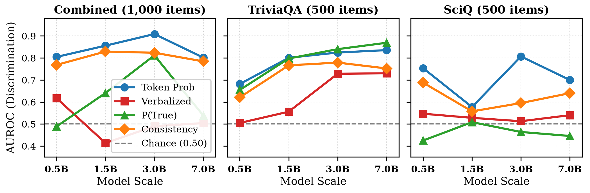
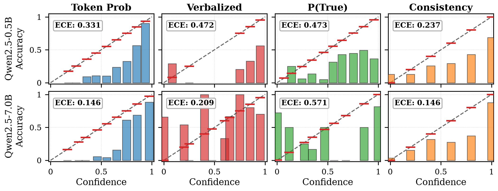
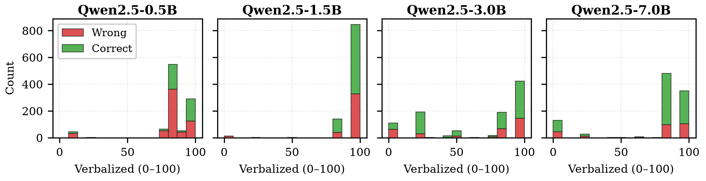

# Confidence Calibration of Small Open LLMs: Token Probability vs. Verbalized vs. Consistency

Author: **Mohammadreza Sharifi** ([m.sharifi8080@gmail.com](mailto:m.sharifi8080@gmail.com))  
Technical Report: [report/report.pdf](report/report.pdf) (4-page academic report)

---

### Key Finding

> While prior literature on large proprietary models suggests that verbalized confidence outperforms token probabilities (e.g., Tian et al., 2023), **this reverses completely for small open LLMs (0.5B–7B)**.
> Verbalized confidence suffers from severe mode collapse (AUROC 0.414–0.618), whereas length-normalized token probability (AUROC up to 0.909) and self-consistency (ECE down to 0.146) provide reliable uncertainty estimation.

---

### Key Visualizations

#### 1. Discrimination Scaling (AUROC vs. Model Size)


#### 2. Calibration Reliability Diagrams (0.5B vs. 7.0B)


#### 3. Failure Mode: Verbalized Confidence Mode Collapse


---

### Research Question

For small instruction-tuned language models (0.5B–7B parameters), which confidence estimation method best separates correct from incorrect answers, and how does calibration scale with model size?

---

### Evaluated Methods

#### 1. Length-Normalized Token Probability ($c_{\text{tok}}$)
Geometric mean of generation token probabilities:

$$\displaystyle c_{\text{tok}} = \exp\left( \frac{1}{N}\sum_{i=1}^N \ln p(t_i \mid t_{1:i-1}) \right)$$

#### 2. Verbalized Confidence ($c_{\text{verb}}$)
Direct numerical elicitation normalized to $[0, 1]$:
> *"How confident are you that this answer is correct? Respond with only a number between 0 and 100."*

$$\displaystyle c_{\text{verb}} = \frac{\text{Score}}{100} \in [0, 1]$$

#### 3. Self-Check $P(\text{True})$ ($c_{\text{ptrue}}$)
Normalized next-token probability of `True` vs. `False` when prompted to verify its own answer (*"Is this answer correct? Answer True or False"*):

$$\displaystyle c_{\text{ptrue}} = \frac{P(\text{True})}{P(\text{True}) + P(\text{False})}$$

#### 4. Self-Consistency ($c_{\text{cons}}$)
Agreement rate across $K = 5$ sampled generations (temperature $T = 0.7$, `top_p = 0.95`):

$$\displaystyle c_{\text{cons}} = \frac{1}{K}\sum_{k=1}^K \mathbb{I}\left(\hat{y}_k = \hat{y}_{\text{greedy}}\right)$$

---

### Benchmark Results

Evaluated on 3,995 total generations across TriviaQA (open-domain QA) and SciQ (multiple-choice science exam) on an Nvidia Tesla T4 GPU.

#### Qwen2.5-0.5B (Accuracy: 38.6%)
| Method | AUROC (Combined) | ECE (Combined) |
|---|---|---|
| Token Prob | **0.805** | 0.331 |
| Consistency | 0.768 | **0.237** |
| Verbalized | 0.618 | 0.472 |
| P(True) | 0.489 | 0.473 |

#### Qwen2.5-1.5B (Accuracy: 61.8%)
| Method | AUROC (Combined) | ECE (Combined) |
|---|---|---|
| Token Prob | **0.856** | 0.204 |
| Consistency | 0.829 | **0.162** |
| P(True) | 0.641 | 0.529 |
| Verbalized | 0.414 | 0.338 |

#### Qwen2.5-3.0B (Accuracy: 67.1%)
| Method | AUROC (Combined) | ECE (Combined) |
|---|---|---|
| Token Prob | **0.909** | 0.222 |
| Consistency | 0.824 | **0.171** |
| P(True) | 0.812 | 0.576 |
| Verbalized | 0.490 | 0.382 |

#### Qwen2.5-7.0B (Accuracy: 73.7%)
| Method | AUROC (Combined) | ECE (Combined) |
|---|---|---|
| Token Prob | **0.802** | **0.146** |
| Consistency | 0.785 | **0.146** |
| P(True) | 0.538 | 0.571 |
| Verbalized | 0.504 | 0.209 |

*All metrics are verified from `results/metrics_table.csv`.*

---

### Key Findings

1. **Token Probability Dominates Discrimination:** Length-normalized token log-probabilities deliver the highest AUROC across all scales (0.802–0.909). Small models possess reliable internal probability signals even when their verbal responses claim false certainty.
2. **Verbalized Confidence Collapses on Small Models:** Asking models to verbalize a score between 0 and 100 fails completely. Scores cluster tightly around 85–95% regardless of correctness, producing near-random AUROC scores (0.414–0.504) on combined queries. Small models lack the metacognitive capacity to inspect internal uncertainty via prompt-based introspection.
3. **Consistency Achieves Lowest Calibration Error:** 5-sample self-consistency achieves the best calibration across all model sizes (ECE 0.146–0.237). Sampling diversity acts as an effective empirical estimator of epistemic uncertainty.
4. **Task Sensitivity of $P(\text{True})$:** $P(\text{True})$ works well on TriviaQA open-generation (AUROC up to 0.869 on 7B), but collapses on SciQ multiple-choice (ECE $> 0.86$) due to severe suggestibility bias: the model assigns high probability to `True` whenever evaluated on an extracted multiple-choice option.

---

### Practical Implication: Cascades and Edge Deployment

In small-to-large model cascades (e.g., Zhang et al., 2026), routing decisions based on verbalized confidence will fail because small models misroute errors with high verbalized certainty. Edge systems and routing controllers should exclusively use internal token probability or 3–5 sample consistency agreement.

---

### Repository Structure

```
p1_calibration_small_llms/
  ├── notebooks/
  │   └── run_p1.ipynb         # Self-contained Colab/Kaggle GPU inference notebook
  ├── src/
  │   ├── data.py              # TriviaQA and SciQ data download and sampling (seed 0)
  │   ├── matcher.py           # Answer normalization and regex extraction
  │   ├── methods.py           # 4 confidence estimation extraction routines
  │   ├── metrics.py           # AUROC, ECE (10 bins), and Brier score implementations
  │   ├── analyze.py           # Metric calculation and publication figure generator
  │   └── check_results.py     # Reviewer verification test suite
  ├── results/
  │   ├── raw/                 # 3,995 individual sample JSONL records from GPU run
  │   ├── metrics_table.csv    # Benchmark metrics table
  │   └── metrics.json         # Raw metrics dictionary
  ├── figures/                 # High-resolution PNG and vector PDF figures
  ├── report/
  │   ├── report.tex           # 4-page academic report source
  │   ├── refs.bib             # Verified bibliography
  │   └── report.pdf           # Compiled 4-page report
  ├── pyproject.toml           # Environment and dependencies
  └── README.md
```

---

### Reproduction Guide

#### 1. Setup Environment
```bash
git clone https://github.com/Mo-sharifi/p1-calibration-small-llms.git
cd p1-calibration-small-llms
uv sync
```

#### 2. Run Inference on GPU (Google Colab / Kaggle T4)
Upload `notebooks/run_p1.ipynb` to Google Colab with a free T4 GPU backend.  
The notebook will:
- Download the fixed 500 TriviaQA and 500 SciQ evaluation items (`results/sample_ids.json`).
- Evaluate Qwen2.5-0.5B, 1.5B, 3B, and 7B (4-bit NF4).
- Extract and save all 4 confidence metrics with auto-resume checkpoints.
- Export results to `results/raw/`.

#### 3. Analyze Results and Generate Figures
```bash
PYTHONPATH=src uv run python src/analyze.py
```
This produces `results/metrics_table.csv`, `results/metrics.json`, and all publication figures in `figures/`.

#### 4. Run Verification Suite
```bash
PYTHONPATH=src uv run python src/check_results.py
```

#### 5. Compile Technical Report
```bash
cd report
pdflatex -interaction=nonstopmode report.tex
bibtex report
pdflatex -interaction=nonstopmode report.tex
pdflatex -interaction=nonstopmode report.tex
```

---

### Limitations

1. **Model Architecture Scope:** Experiments were conducted within the Qwen2.5 model family (0.5B to 7B) to isolate parameter scale while keeping tokenizer and training recipes constant. Evaluating across additional model families (e.g., Llama-3.2, Gemma-2, SmolLM) remains valuable future work.
2. **Task Breadth:** The study focuses on open-domain factual generation (TriviaQA) and multiple-choice science examination (SciQ). Multi-hop reasoning (e.g., GSM8K) or open-ended generation may exhibit additional calibration factors.
3. **Recalibration Techniques:** Confidence methods were benchmarked in a direct, zero-training setting without post-hoc recalibration techniques such as temperature scaling, conformal prediction, or distractor normalization.

---

### Citation

```bibtex
@article{sharifi2026confidence,
  title={Confidence Calibration of Small Open LLMs: Token Probability vs. Verbalized vs. Consistency},
  author={Sharifi, Mohammadreza},
  journal={arXiv preprint in preparation},
  year={2026}
}
```
